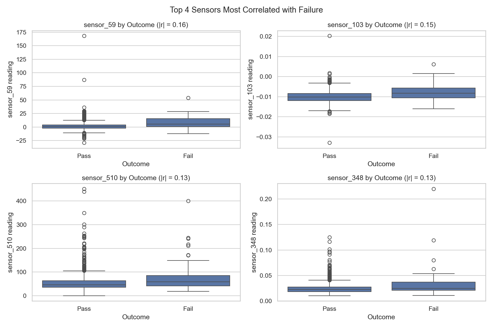
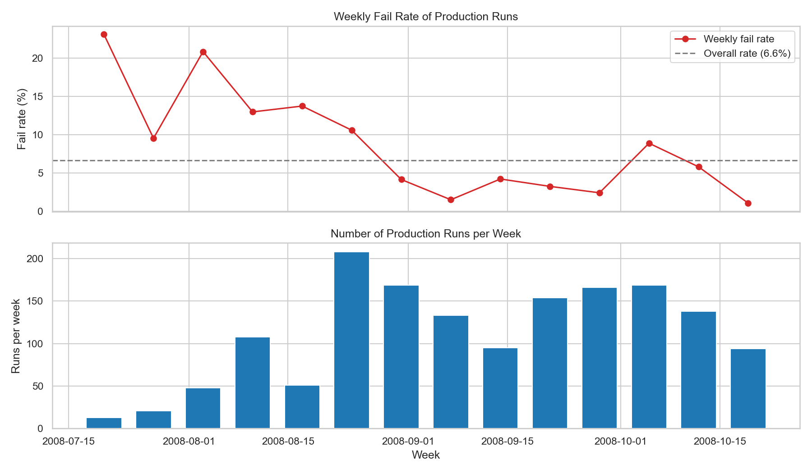
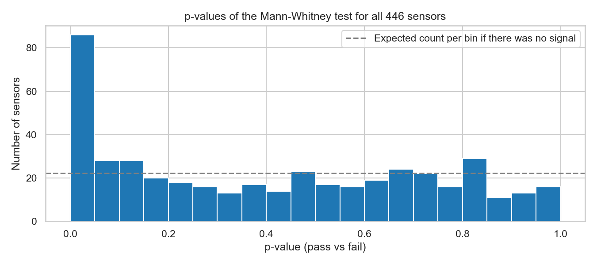
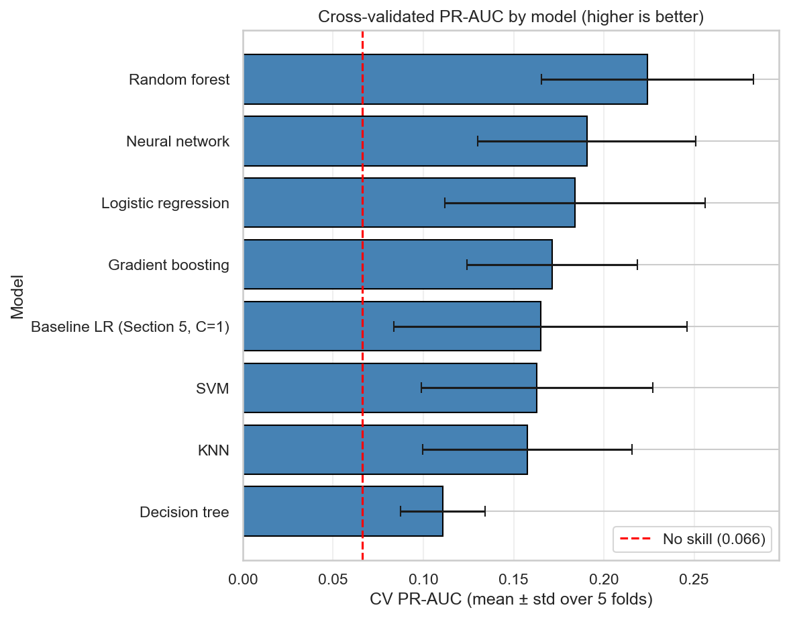
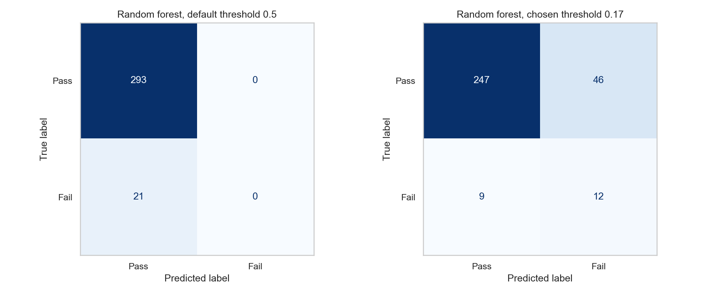
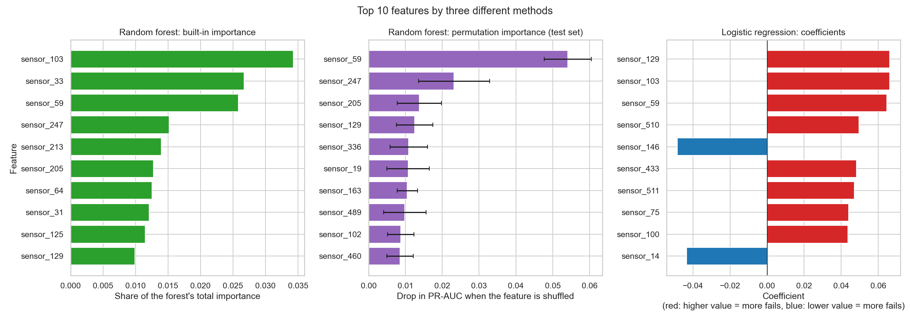
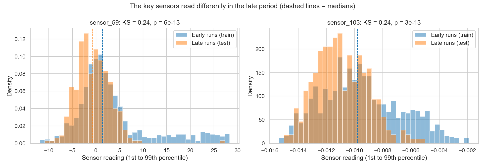
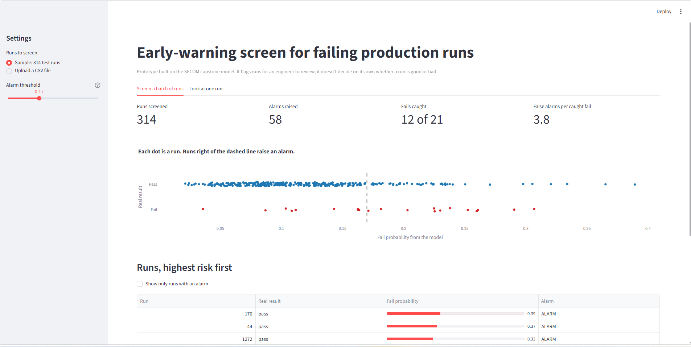
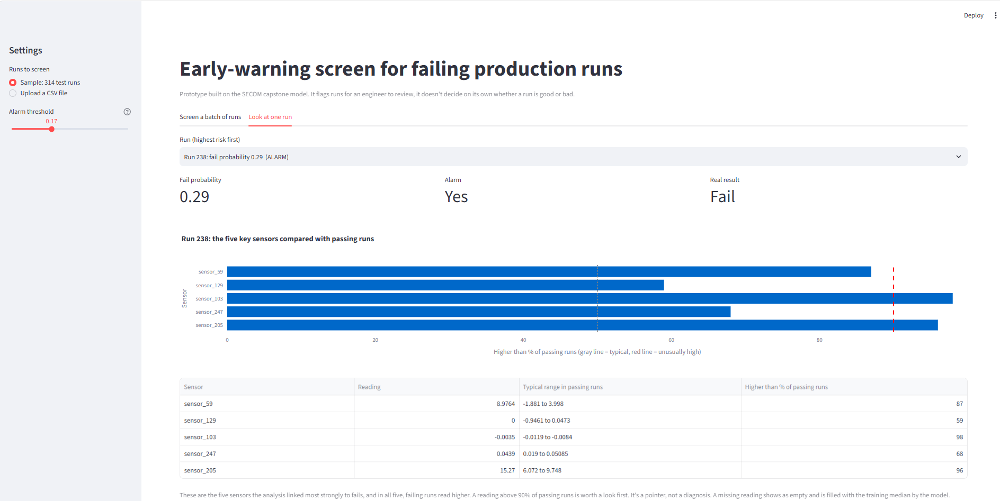

# Predicting Semiconductor Yield Failures from In-Line Process Sensors

**Author:** Sasan Shadpour

Capstone project for the UC Berkeley Professional Certificate in Machine Learning and Artificial Intelligence.

## Executive summary

### Project overview and goals

In a semiconductor fab, most production runs pass the final quality test. The few that fail are usually found late, after more tool time and material have gone into wafers that were already bad. At the same time, in-line sensors record hundreds of signals for every run, and nobody can watch all of them. I wanted to know whether those signals can warn of a failing run early, and which sensors give the warning.

I worked with SECOM, a public dataset from a real fab: 1,567 production runs, 590 sensors per run, and only 104 failures. The goal was a model that gives every run a fail risk score and raises an alarm when the score is high enough. It should catch as many failing runs as possible, keep the false alarms at a level engineers can handle, and point to a short list of sensors worth watching.

### Findings

- The sensors do carry a warning signal, but it's weak and spread over many of them. No single sensor gives a failing run away.
- I compared seven models, and a random forest worked best. On runs it had never seen, its score was about 3.5 times the level of random guessing.
- With an alarm threshold set for the fab ("catch at least half of the fails"), it caught 12 of the 21 failing runs in the test data, about 6 in 10. About 1 in 5 alarms was a real fail. My first simple model caught only 4 of the 21, with almost 10 false alarms for each fail it found.
- Five sensors keep coming up: sensor_59, sensor_129, sensor_103, sensor_247 and sensor_205. In all five, a higher reading means a higher risk, and sensor_59 is the strongest warning sign.
- The process changed during the three months. The fail rate dropped from 10.5% in July–August to 4.1% in September–October, and most sensors read differently in October. A model trained only on older runs caught just 4 of the 17 fails in the newest runs.

### What it means

The model is good enough to work as an early-warning screen that points engineers to the runs worth a closer look. It isn't good enough to hold or scrap wafers on its own. Because the process drifts, it also has to be retrained and checked regularly.

### Next steps

Have process engineers check the five sensors, set the alarm threshold from real costs, run the model in a trial period next to the normal quality test, and collect more failing runs.

## Rationale

A fail that is found only at the final test means the wafer went through every remaining process step first. The tool time, the materials and the engineers' time spent on it are lost, and the root-cause work starts late, when the conditions that caused the problem may already be gone. Catching even part of these runs earlier saves money and shortens the time to find the cause.

There are two kinds of mistakes, and they don't cost the same:

- A missed fail costs the most: bad wafers keep moving through the line, and the problem is found late.
- A false alarm costs an engineer's time to check a run that turns out to be fine. That's cheaper, but if there are too many alarms, people stop trusting them.

That's why I judged the models on how many fails they catch and how many false alarms each catch costs, not on accuracy. Accuracy is misleading here: a "model" that always says pass is 93% accurate and catches nothing.

There's also a second problem: hundreds of sensors and no clear idea which ones matter. A short, evidence-based list of sensors gives engineers a place to start monitoring and root-cause work. This is the idea behind virtual metrology, predicting a quality result from process data instead of waiting for the measurement.

## Research question

Can in-line process sensor data predict whether a production run will fail the final quality test, and which sensors are the strongest early warning signs?

## Data sources

**SECOM dataset:** McCann, M. & Johnston, A. (2008). SECOM [Dataset]. UCI Machine Learning Repository. https://archive.ics.uci.edu/dataset/179/secom

- 1,567 production runs from a semiconductor fab, recorded from 19 July to 17 October 2008
- 590 anonymized sensor signals per run
- A pass/fail result from the fab's own testing, plus a timestamp for each run
- Only 104 runs (6.6%) failed, so failures are rare

The data comes from one public source in two linked files: `secom.data` holds the sensor readings and `secom_labels.data` holds the pass/fail result and timestamp for the same runs, plus `secom.names` describing the dataset. I chose it because it has the same problems as real fab data: missing readings, redundant sensors and very few fails. Other data sources couldn't be added, since the sensors are anonymized and company data can't be shared (see the note below).

> **Note on the project change:** my earlier problem statement was a surrogate model built on company simulation data. Because of my employer's data policy I can't use that data in a public project, so I switched to the public SECOM dataset. The topic, using semiconductor process data to predict outcomes, stays the same, but the problem changed from regression to classification.

Before building any model, I checked whether the data could answer the question at all. The box plots below show the four sensors most related to failure. Failing runs tend to read higher, but the two groups overlap a lot. A statistical test over all sensors (see Results) confirmed that the difference is real, so there's a signal to work with.



## Methodology

**Type of model.** This is supervised learning, more exactly binary classification: every past run is labeled pass or fail, and the model learns from that history. For each new run it gives a fail probability, and an alarm goes off when the probability is above a chosen threshold.

1. **Cleaning.** I removed 28 sensors with more than half of their readings missing and 116 sensors that never change. There were no duplicate runs or sensors. The remaining gaps (1.6% of the readings) are filled with the median inside the model pipeline, so the fill values are learned from the training data only. Almost every run (1,566 of 1,567) has at least one unusual reading. I kept them, because in process data an outlier is often a real excursion, exactly the kind of event that can cause a fail.
2. **Exploration and statistics.** I looked at the fail rate over time, the sensor readings of passing and failing runs, correlations between sensors and outliers. Besides descriptive statistics (mean, median, spread), I used hypothesis tests to check whether the patterns are real: the Mann-Whitney U test for differences between passing and failing runs, and the chi-square test for differences in the fail rate between periods and weekdays.
3. **Feature engineering.** I added the hour and the day of the week from the timestamp and removed 174 sensors that were near copies of another sensor (correlation above 0.95). I also looked at PCA, but kept the original sensors so the results stay explainable. That leaves 272 sensors and 2 time features. All features are numbers, so no encoding was needed.
4. **Train/test split.** I set aside 20% of the runs as a test set (314 runs, 21 fails), keeping the same share of fails in both parts. All tuning used 5-fold cross-validation on the other 1,253 runs, and the test set was used only once at the end. Later I also split the runs by time, training on the first 80% and testing on the last 20%, to see how the model does on future production.
5. **Models.** After a "dummy" model that always says pass and a first logistic regression as the baseline, I tuned seven models with grid search: logistic regression, k-nearest neighbors, a decision tree, a support vector machine, a random forest, gradient boosting and a small neural network. The models give extra weight to the rare failing runs (class weights). I also tested resampling the training data instead (SMOTE, undersampling and a balanced random forest).
6. **Alarm threshold.** I chose the threshold on cross-validated scores of the training runs, never on the test set, and cross-checked it with scikit-learn's automatic threshold tuning.
7. **Interpretation.** I ranked the sensors with three methods (the random forest's own importance, permutation importance and the logistic regression coefficients) and compared the result with the statistical tests.
8. **Drift check.** I used the Kolmogorov–Smirnov test to see which sensors read differently in the latest runs than before.
9. **From model to app.** I saved the final model and built a small prototype app around it: an API that scores runs and a screen for engineers (see "Early-warning app" below).

**How I measured success.** The main metric is PR-AUC (average precision). It measures how well a model puts the failing runs at the top of its list, on a scale from 0 to 1. Random guessing scores the share of fails, 0.067, so that's the bar to beat. The second metric is recall, the share of failing runs that get caught. For the fab I translate both into plain numbers: fails caught, and false alarms per caught fail.

## Results

### What the data showed

The fail rate changed over time. It was 10–23% per week in July and August and dropped to about 1–4% from September. The chi-square test confirms this isn't chance (10.5% vs 4.1%, p ≈ 0.000001), which points to a process change around the end of August. The higher fail rate on Sundays, on the other hand, can easily be chance (p ≈ 0.24).



The warning signal is real, but weak and spread out. No sensor has a correlation with failure above 0.16. When I tested every sensor, 86 of 446 differed between passing and failing runs, while chance alone would give about 22. That's the spike on the left of the chart below. Only 9 sensors passed the strictest version of the test (the Bonferroni correction), so there's no single smoking gun, and a model has to combine many weak signals.



### Comparing the models

| Model | Cross-validation PR-AUC | Test PR-AUC | ROC-AUC (test) |
|---|---|---|---|
| Dummy (always says pass) | - | 0.067 | 0.50 |
| Baseline logistic regression | 0.165 | 0.143 | 0.64 |
| **Random forest** | **0.224** | **0.234** | **0.78** |
| Neural network | 0.191 | 0.149 | 0.64 |
| Logistic regression (tuned) | 0.184 | 0.156 | 0.68 |
| Gradient boosting | 0.171 | 0.198 | 0.71 |
| Support vector machine | 0.163 | 0.174 | 0.70 |
| K-nearest neighbors | 0.158 | 0.141 | 0.69 |
| Decision tree | 0.111 | 0.072 | 0.52 |



The random forest came out on top both in cross-validation and on the test set. Averaging hundreds of trees suits data where the signal is weak and spread over many sensors. Its best settings all keep the trees simple, which confirms that overfitting was what held the baseline back.

Two results surprised me. The neural network came second in cross-validation, but it had memorized its training runs (a perfect score on them), its score depended on its random starting point, and on the test set it fell to fifth place. With only 83 failing runs to learn from, a more flexible model just memorizes more. And resampling the training data didn't help either: none of the three resampling methods beat simple class weights.

With only 21 failing test runs, every score is uncertain. A bootstrap confidence interval puts the forest's test PR-AUC between 0.125 and 0.412. Even the low end is about twice the random level.

### Turning the model into an alarm

The forest ranked the runs well, but at the standard cut-off of 0.5 it never raised a single alarm, because none of its scores were that high. So I set the threshold myself, with a rule a fab manager could agree to: catch at least half of the failing runs with as few false alarms as possible. On the training data that rule gives a threshold of 0.17.



On the test set, the chosen threshold catches 12 of the 21 failing runs and raises 46 false alarms. About 1 in 5 alarms is a real fail, so a flagged run is about three times more likely to fail than a random run (21% vs 6.7%). That's about 3.8 false alarms for every fail caught, compared with about 9.5 for the baseline. scikit-learn's automatic threshold tuning picked 0.13, a more cautious point on the same trade-off: it catches 16 of 21 fails, but with 104 false alarms.

The threshold is a knob. These are the options, based on cross-validation on the training runs:

| Threshold | Fails caught (out of 10) | False alarms per caught fail |
|---|---|---|
| 0.10 | about 8 | about 9 |
| 0.15 | about 6 | about 6 |
| 0.17 (chosen) | about 5 | about 5 |
| 0.20 | 4 | 4 |
| 0.25 | about 2 | 3 |

### The sensors behind the alarms



The three ranking methods look different at first, but the same names keep coming back. Five sensors are in the top 10 of at least two methods: sensor_59, sensor_129, sensor_103, sensor_247 and sensor_205. All five also passed the strict statistical test, so two completely different approaches point to the same small group. In all five, failing runs read higher than passing runs. sensor_59 is the clearest signal: it's in the top 3 of every method, and its typical reading is about 7 times higher in failing runs. The hour and day of the week hardly matter, the alarms come from the process sensors themselves.

### Does it work on later production?

A random split mixes old and new runs, but a real fab trains on the past and uses the model on the future. So I trained the same forest on the runs up to 2 October and tested it on the last two weeks. The result is clearly weaker: PR-AUC 0.129 (random level 0.054), and with the same threshold it caught 4 of the 17 fails, with 18 false alarms.

The reason is drift. The Kolmogorov–Smirnov test found that 229 of the 272 sensors read differently in the late runs, including all five key sensors. In the early runs, sensor_59 and sensor_103 had a long tail of high readings, the readings that went with fails. In October that tail almost disappears. Fewer high readings fits the lower fail rate, but it also means the model rarely sees the patterns it learned to raise alarms on.



## Findings and recommendations

The journey in one table:

| Step | Fails caught (test) | False alarms per caught fail |
|---|---|---|
| Always say pass | 0 of 21 | - |
| Baseline logistic regression | 4 of 21 | 9.5 |
| Random forest, standard threshold | 0 of 21 | - |
| Random forest, chosen threshold (0.17) | 12 of 21 | 3.8 |
| Same forest, trained on early runs, tested on late runs | 4 of 17 | 4.5 |

What I would recommend to the fab:

1. **Use the model as an early-warning screen, not an automatic decision.** Runs above the threshold go to an engineer for a closer look. Nothing gets held or scrapped on the model's word alone.
2. **Set the threshold from real costs.** If a missed fail is very expensive, move the threshold down (on the test set, 0.13 caught 16 of 21 fails, but with many more false alarms), and if engineers are overloaded, move it up. The options table above shows what each setting means.
3. **Put the five sensors on a watch list, starting with sensor_59.** A climbing reading on these sensors is the warning sign to look for.
4. **Ask the process engineers who know the real sensor names to check the five sensors.** The data is anonymized, so I can't say what sensor_59 measures. If the link makes physical sense, it's also a starting point for root-cause work.
5. **Retrain on recent runs and check for drift regularly.** For example once a month and after every process change: run a drift test on the key sensors and review the threshold. A model trained once and left alone will get worse.
6. **Collect more failing runs.** With 104 fails in total, every score is uncertain. More fail data is worth more than a more complex model or synthetic data: the neural network and resampling both didn't help.

**How it could run in the fab.** The model would score each run as soon as its sensor data is complete, on the fab's own servers, so the data stays on site. An alarm would go to the process engineer together with the readings of the five key sensors. The engineer confirms or rejects each alarm, and those answers become new labels for the next retraining. I'd start in "shadow mode": run the model for a few weeks next to the normal process without acting on its alarms, and compare them with the final test results before anyone relies on it. The prototype app below shows what the engineer's screen could look like.

### Limitations

- Only 104 fails in the whole dataset and 21 in the test set, so all scores come with wide uncertainty.
- The process drifted, so the random-split results are a best case. On the newest runs the model is weaker.
- The sensors are anonymized, so the results can't be linked to physical process parameters yet.
- The data covers one process over about three months, and I don't know exactly how a "fail" was defined in the fab's test.

## Next steps

- Review the five sensors with process engineers and look for a physical explanation.
- Run a shadow-mode trial and measure how many alarms turn out to be real.
- Validate the model on a rolling time window instead of a random split, and set up automatic retraining and drift checks.
- Set the threshold from real costs: what a missed fail costs versus an engineer's time for a false alarm.
- Collect more failing runs, and if more data becomes available, try separate models per tool or process step.

## Early-warning app (prototype)

To show how the model could be used day to day, I built a small app on top of it. It follows the usual steps for putting a model into use: the notebook saves the trained model to a file, an API serves it, and a simple screen calls the API.

- The API (`app/api.py`, built with FastAPI) loads the model once and answers requests. You send it the sensor readings of one or many runs, and it returns a fail probability and an alarm for each one. Other systems in a fab, like a dashboard or the tool software, could call the same API.
- The screen (`app/ui.py`, built with Streamlit) has two tabs. "Screen a batch of runs" scores a batch of runs (the 314 test runs, or your own CSV file) and shows how many alarms it raises and, when the real results are known, how many fails it caught. A slider moves the threshold, so you can watch the trade-off between caught fails and false alarms change. "Look at one run" shows a run's fail probability and where its five key sensors sit compared with passing runs, as a pointer for where an engineer could look first.

On the sample runs the app gives exactly the notebook's result: 58 alarms at the 0.17 threshold, catching 12 of the 21 fails.



*The batch screen with the 314 test runs. Each dot is a run, and every run to the right of the dashed line raises an alarm. At the 0.17 threshold it catches 12 of the 21 fails. Moving the slider down to 0.13 catches 16 of them, but the false alarms per caught fail go up from 3.8 to 6.5.*



*Run 238 raised an alarm and really did fail. Three of its key sensors read higher than almost all passing runs (sensor_103 higher than 98% of them, sensor_205 than 96%, sensor_59 than 87%), so that's where an engineer would start looking.*

**How to run it.** From the main folder of this repository, install the packages once, then start the API and the screen in two terminals:

```
pip install -r requirements.txt
python -m fastapi dev app/api.py      # terminal 1: the model API at http://127.0.0.1:8000 (try it at /docs)
python -m streamlit run app/ui.py     # terminal 2: the screen opens in the browser
```

It's a prototype: it runs on one computer, has no login and uses the model trained in the notebook. A real version would run on the fab's own servers with access control, and the model file would be replaced after every retraining.

## Outline of project

- [Main notebook: `notebooks/secom_capstone.ipynb`](notebooks/secom_capstone.ipynb)

The notebook tells the whole story in 12 sections:

1. Data Loading & Inspection
2. Data Cleaning
3. Exploratory Data Analysis, including the statistical tests
4. Feature Engineering
5. Baseline Model and the choice of metric
6. Model Comparison: seven models tuned with grid search and cross-validation, and a check of resampling methods
7. Evaluation on the Test Set
8. Choosing the Alarm Threshold
9. Which Sensors Drive the Alarms?
10. Checking the Model on Later Production
11. From Model to App: saving the model for the early-warning app
12. Conclusions


**Project structure**

```
├── README.md
├── requirements.txt               # Python packages for the notebook and the app
├── data/                          # SECOM raw files (UCI)
│   ├── secom.data                 # sensor readings
│   ├── secom_labels.data          # pass/fail result + timestamp
│   └── secom.names                # dataset description
├── notebooks/
│   └── secom_capstone.ipynb       # the full analysis
├── app/                           # early-warning app (prototype)
│   ├── api.py                     # FastAPI service that scores runs
│   ├── ui.py                      # Streamlit screen
│   ├── secom_alarm_model.joblib   # saved model (created by the notebook, Section 11)
│   ├── sample_runs.csv            # the 314 test runs as example data
│   └── reference_pass_runs.csv    # key-sensor readings of passing runs
└── images/                        # figures saved by the notebook
```

## Contact and further information

Sasan Shadpour, GitHub: [Sassan-87](https://github.com/Sassan-87)

Dataset: McCann, M. & Johnston, A. (2008). SECOM [Dataset]. UCI Machine Learning Repository. https://archive.ics.uci.edu/dataset/179/secom
